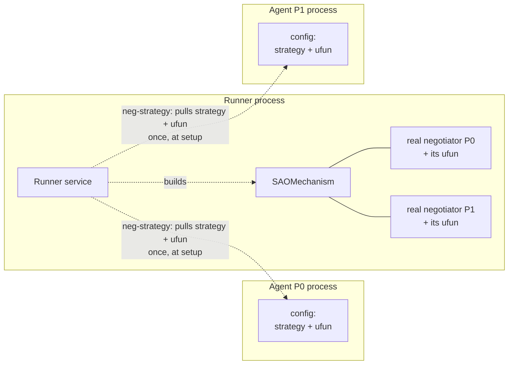
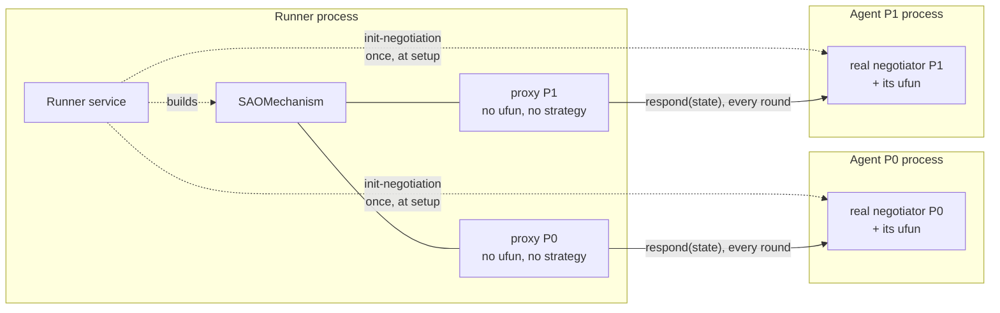

# negmasd

Run any [negmas](https://github.com/yasserfarouk/negmas) negotiation **distributedly** — each negotiator (and, optionally, each utility function) in its own process or machine — while reaching **bit-exact parity** with an ordinary in-process negmas run.

negmasd reuses negmas's own `SAOMechanism`; it does not reimplement the protocol. Only **values** cross the wire (plain JSON, never pickled objects), so the pieces can run under different Python versions or on different machines.

The wire is pluggable: **HTTP** (FastAPI) always, plus **gRPC** and **MQTT** as optional extras. The roles themselves contain no networking code — see [Transports](docs/transports.md).

## The central distinction: two execution modes

Every negotiation declares a `mode` (default `distributed`) — it is a property of
the *negotiation*, not a server-wide switch, so one runner can serve both at once.

In both modes the runner runs the real `SAOMechanism`. What differs is **where each
party's strategy and ufun live**, and therefore **who computes each response**.

### `centralized` — strategies move to the runner

The runner pulls each party's strategy + ufun **once, at setup**, builds the
negotiators in its own process, and runs the whole negotiation locally. No traffic
during the negotiation; the runner sees everything.



### `distributed` (default) — decisions move to the owners

The runner runs the mechanism with one **proxy** negotiator per party — holding no
ufun and no strategy — and forwards **every round** to the party's own process,
where the real negotiator runs. Strategy and ufun never leave their owner.



In both modes the runner delivers the final `receive-results` to every party when
`mechanism.run()` returns, so that part of the picture is identical and is left out
of both diagrams.

The two diagrams are deliberately the same shape: read them for the two real
differences — **where the ufun box sits**, and **once at setup vs. every round**.

Both modes reach exact parity with negmas-proper for `n_steps`-bounded
negotiations. Independently of the mode, a ufun can live in *yet another* process
(`RemoteUtilityFunction`) — see [Execution modes](docs/modes.md).

## Installation

After installing [uv](https://docs.astral.sh/uv/), clone this repo then:

```bash
uv sync                             # HTTP only
uv sync --extra grpc                # ...plus the optional gRPC transport
uv sync --extra mqtt                # ...plus the optional MQTT transport
uv sync --extra grpc --extra mqtt   # ...both
```

Neither `grpcio` nor `paho-mqtt` is ever required — everything works without them.

## The three roles

- **Agent** (`negmasd.agent`) — one per negotiator; holds that party's private strategy + ufun.
- **Runner** (`negmasd.runner`) — runs the real `SAOMechanism`; one shared service.
- **ufun service** (`negmasd.ufun_service`) — *(optional)* holds a ufun and evaluates outcomes for a `RemoteUtilityFunction`.

Each role is a plain Python service that declares a *method table*; a transport adapter projects it onto HTTP, gRPC or MQTT, so negotiation logic never names a protocol. The arrows in the diagrams above are method names, not URLs.

An *app* is a folder of configs (`runner.yml` + `agents/*.yml`). See `src/negmasd/apps/procurement` for an example.

## Quick try

```bash
negmasd builtin procurement
```

This starts a runner (9010), a buyer (8001) and a seller (8002) and loads their configs. Those ports are *preferred*: if one is taken, `builtin` picks a free port and rewrites the app's configs to match. It prints what it chose:

```console
builtin ready: {"protocol": "http", "host": "127.0.0.1", "runner": 9010, "agents": {"buyer": 8001, "seller": 8002}, "configs": "/tmp/negmasd-procurement-ab12cd"}
```

Open <http://127.0.0.1:8001/docs>, call `/start-negotiation` with `neg = trade`, then `/peak` (on the buyer or the runner at <http://127.0.0.1:9010/docs>) to see the result.

To run the whole thing over gRPC instead:

```bash
negmasd builtin procurement --protocol grpc
```

`--protocol http|grpc|mqtt` works on `runner`, `agent` and `ufun` (MQTT also needs
`--broker host:port`; `builtin` is HTTP/gRPC only). See the full CLI with:

```bash
negmasd --help
```

## Tests

negmasd is validated by **exact parity** against plain negmas: the same scenario, run distributedly, reaches the same agreement, step and timeout flag.

```bash
uv run pytest                 # everything (includes real-subprocess HTTP and gRPC tests)
uv run pytest -m "not slow"   # skip the subprocess tests
```

The gRPC and MQTT cases skip automatically when their optional extras are absent,
and `tests/test_transport_optional.py` asserts that nothing on the HTTP path imports
`grpc` or `paho` at all. The MQTT suite runs against a real broker started
in-process (`amqtt`, dev group), so it needs no mosquitto.

## Documentation

Full docs (Material for MkDocs):

```bash
uv run mkdocs serve           # live preview at http://127.0.0.1:8000
uv run mkdocs build           # static site in ./site
```

Start with `docs/index.md`, then **Architecture**, **Execution modes**, **Exact parity** and **Transports**.

Release notes live in [CHANGELOG.md](CHANGELOG.md).
