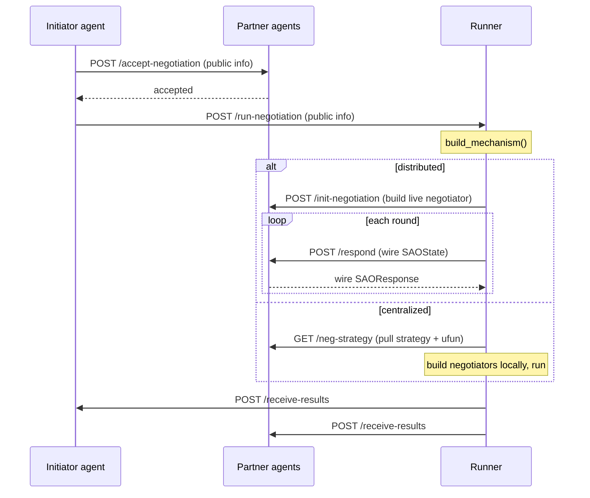
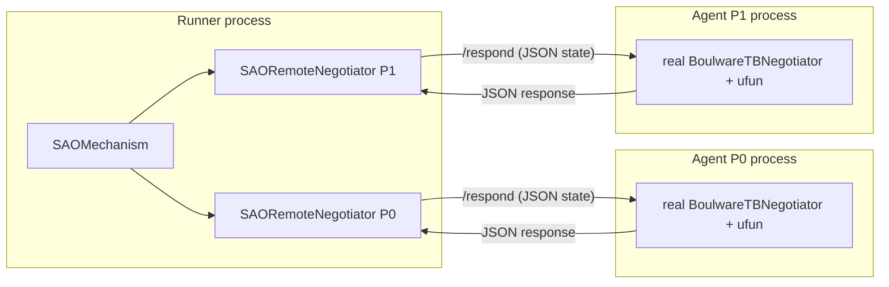

# Architecture

negmasd has three process roles, each a [FastAPI](https://fastapi.tiangolo.com/) app, driven entirely over HTTP.

| Role | Module | Holds | Responsibility |
|------|--------|-------|----------------|
| **Agent** | `negmasd.agent` | one party's *private* strategy + ufun | accept/run handshake; compute that party's per-round responses (distributed mode) |
| **Runner** | `negmasd.runner` | nothing private | build and run the real `SAOMechanism`; report results |
| **ufun service** | `negmasd.ufun_service` | a ufun (+ its outcome space) | evaluate outcomes for a `RemoteUtilityFunction` |

A negotiation **app** is a folder under `negmasd/apps/<name>/` containing `runner.yml` and `agents/*.yml`. The CLI's `builtin` command launches an app's processes and loads their configs.

## The negotiation handshake

The **initiator** strips its private fields (`PersonalNegotiationModel.remove_personal_info()`) before sending the public `NegotiationModel` to partners and the runner. Private strategy + ufun never appear in the public payload.

## Distributed execution

In distributed mode the runner builds the real `SAOMechanism` but adds one **`SAORemoteNegotiator`** per partner instead of the partner's real strategy. The proxy:

- holds **no ufun and no strategy**,
- on each `__call__(state)`, encodes the state, `POST`s it to the partner's `/respond`, and decodes the returned `SAOResponse`.

The partner's process builds its **real** negotiator once (in `/init-negotiation`, stored in `agent.live_negotiators`) and runs it on each `/respond` call. Because a time-based negotiator's decision is a pure function of the *passed* state plus its own ufun, feeding it the exact per-round states the mechanism produces reproduces an in-process run exactly.

The synchronous mechanism loop runs in a worker thread (`asyncio.to_thread`) so the per-round blocking HTTP calls don't stall the runner's event loop.

## The wire (`negmasd.wire`)

The runner and agents may run different Python versions or live on different machines, so the wire format is **plain JSON with an explicit schema** — never pickle, never `negmas.serialization.serialize` for runtime objects. Two invariants make it exact:

1. `ResponseType` is an `IntEnum`; it is carried as its integer `.value`. (negmas's own `serialize` drops it to `{}`, which would lose every ACCEPT.)
2. negmas outcomes are **tuples**; JSON has only arrays, so every outcome is **re-tupled on decode**. (A list left un-tupled makes `ufun(offer)` return `None`, so the negotiator silently rejects everything.)

See [Exact parity](parity.md) for the determinism and cross-machine story.

## Object construction from config

Every negmas object (mechanism, outcome space, negotiator, ufun) is declared in YAML by its dotted path under a `type:` field plus constructor kwargs. `MakableModel.make_object` (in `negmasd.models`) feeds that into negmas's `deserialize`. Because `RemoteUtilityFunction` is just another `type`, an agent builds a remote ufun with no special-casing — see [Configuration](configuration.md).
