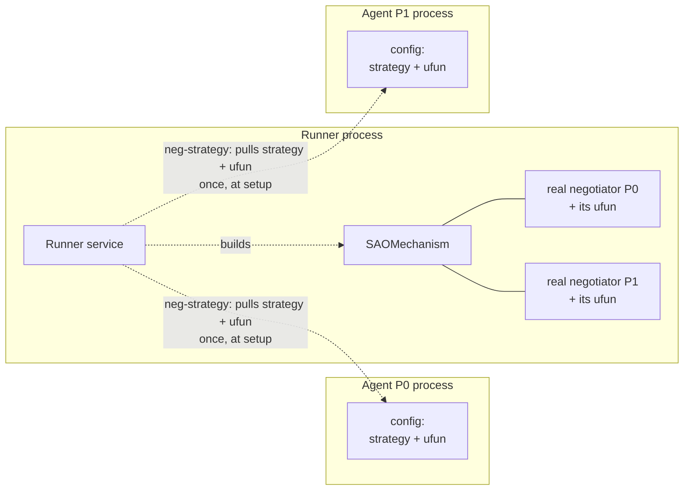
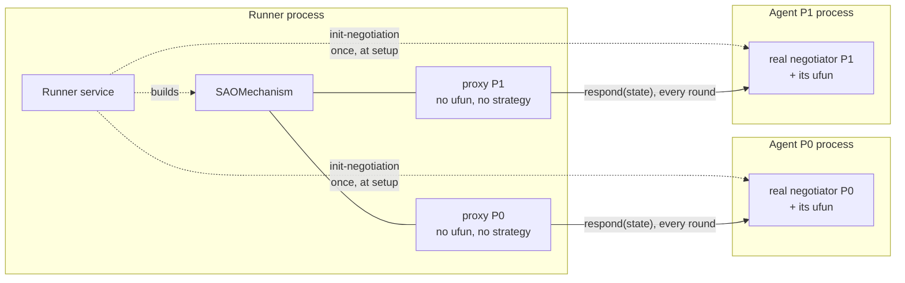

# negmasd

**negmasd** runs any [negmas](https://github.com/yasserfarouk/negmas) negotiation with its pieces split across processes or machines — each negotiator (and, optionally, each utility function) in its own process — while reaching **bit-exact parity** with an ordinary in-process negmas run.

It reuses negmas's own `SAOMechanism`; it does **not** reimplement the negotiation protocol. That is what makes exact parity achievable.

## The central distinction: two execution modes

Every negotiation declares a `mode` — it is a property of the **negotiation**
(`NegotiationModel.mode`, default `distributed`), not a server-wide switch, so one
runner can serve both at once.

In both modes the runner runs the real `SAOMechanism`. What differs is **where each
party's strategy and ufun live**, and therefore **who computes each response**.

### `centralized` — strategies move to the runner

The runner pulls each party's strategy + ufun **once, at setup**, builds the
negotiators in its own process, and runs the whole negotiation locally.

Every strategy and ufun ends up **inside the runner**. No traffic during the
negotiation; the runner sees everything.

### `distributed` (default) — decisions move to the owners

The runner runs the mechanism with one **proxy** negotiator per party and
forwards **every round** to the party's own process, which runs the real
negotiator there.

Every strategy and ufun **stays in its owner's process**; the runner only ever
holds a no-ufun proxy and sees one JSON response per round.

In both modes the runner delivers the final `receive-results` to every party when
`mechanism.run()` returns, so that part of the picture is identical and is left out
of both diagrams.

The two diagrams are deliberately the same shape: read them for the two real
differences — **where the ufun box sits**, and **once at setup vs. every round**.

Both modes reach exact parity with negmas-proper for `n_steps`-bounded
negotiations. See [Execution modes](modes.md) for when to pick which, and for the
third level (a ufun in *yet another* process).

## Why

A negotiation usually runs in one process: the mechanism, every negotiator, and every utility function share memory. That is fine for simulation, but not when:

- negotiators are owned by different parties who will not share their strategy or ufun,
- a ufun is proprietary, huge, or backed by a service the negotiator's owner cannot ship,
- parties run different Python versions, or live on different machines.

`distributed` mode answers exactly that: only **values** cross the wire (plain JSON — never pickled objects), so the pieces can run anywhere.

The wire itself is pluggable: HTTP (FastAPI) always, plus **gRPC** and **MQTT** as optional extras. Roles declare *what* they can do and adapters project that onto a protocol, so switching transport is a deployment choice rather than a rewrite — see [Transports](transports.md).

## The three roles

- **Agent** — one per negotiator; holds that party's private strategy + ufun.
- **Runner** — runs the real `SAOMechanism`; one shared service.
- **ufun service** *(optional)* — holds a ufun and evaluates outcomes for a `RemoteUtilityFunction`.

Each role is a plain Python service that declares a *method table*; a transport
adapter projects it onto HTTP, gRPC or MQTT. The arrows in the diagrams above are
method names, not URLs.

## Next steps

- [Quickstart](quickstart.md) — run a negotiation in a few commands.
- [Execution modes](modes.md) — the two modes in detail, plus remote ufuns.
- [Architecture](architecture.md) — how the handshake and the wire work.
- [Exact parity](parity.md) — why it is exact, and the proven envelope.
- [Transports](transports.md) — the transport-independent design, HTTP/gRPC/MQTT, and how to add a protocol.
- [Changelog](changelog.md) — what changed.
