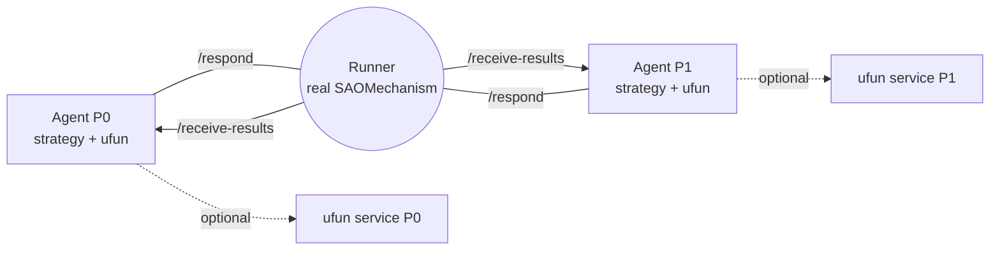

# negmasd

**negmasd** runs any [negmas](https://github.com/yasserfarouk/negmas) negotiation with its pieces split across processes or machines — each negotiator (and, optionally, each utility function) in its own process — while reaching **bit-exact parity** with an ordinary in-process negmas run.

It reuses negmas's own `SAOMechanism`; it does **not** reimplement the negotiation protocol. The runner runs the real mechanism and forwards only the per-round decisions to the processes that own them. That is what makes exact parity achievable.

## Why

A negotiation usually runs in one process: the mechanism, every negotiator, and every utility function share memory. That is fine for simulation, but not when:

- negotiators are owned by different parties who will not share their strategy or ufun,
- a ufun is proprietary, huge, or backed by a service the negotiator's owner cannot ship,
- parties run different Python versions, or live on different machines.

negmasd keeps each party's strategy and ufun in that party's own process. Only **values** cross the wire (plain JSON — never pickled objects), so the pieces can run anywhere.

The wire itself is pluggable: HTTP (FastAPI) always, plus **gRPC** and **MQTT** as optional extras. Roles declare *what* they can do and adapters project that onto a protocol, so switching transport is a deployment choice rather than a rewrite — see [Transports](transports.md).

## The three roles

- **Agent** — one per negotiator; holds that party's private strategy + ufun.
- **Runner** — runs the real `SAOMechanism`; one shared service.
- **ufun service** *(optional)* — holds a ufun and evaluates outcomes for a `RemoteUtilityFunction`.

Each role is a plain Python service that declares a *method table*; a transport
adapter projects it onto HTTP or gRPC. The arrows above are method names, not
URLs.

## Two execution modes

| Mode | What runs where |
|------|-----------------|
| **`centralized`** | the runner pulls each party's strategy + ufun and runs the whole negotiation locally |
| **`distributed`** | the runner runs the mechanism but forwards every per-round `negotiator(state)` to the party's own process |

Both reach exact parity with negmas-proper. See [Execution modes](modes.md).

## Next steps

- [Quickstart](quickstart.md) — run a negotiation in a few commands.
- [Architecture](architecture.md) — how the handshake and the wire work.
- [Exact parity](parity.md) — why it is exact, and the proven envelope.
- [Transports](transports.md) — the transport-independent design, HTTP/gRPC/MQTT, and how to add a protocol.
- [Changelog](changelog.md) — what changed.
