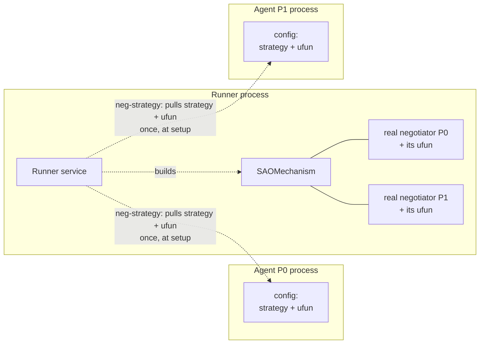
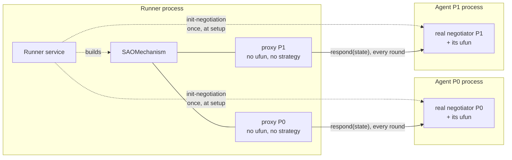
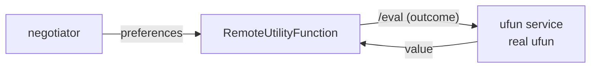

# Execution modes

Each **negotiation** declares a `mode` (`NegotiationModel.mode`, default
`distributed`). It is per-negotiation, not per-server: one runner can serve both
modes at the same time.

In both modes the runner runs the real `SAOMechanism` — negmasd never
reimplements the protocol. What differs is **where each party's strategy and ufun
live**, and therefore **who computes each response**. Both reach **bit-exact
parity** with negmas-proper for step-bounded negotiations.

## `centralized`

The runner pulls each partner's strategy + ufun (via `neg-strategy`) **once, at
setup**, builds the negotiators locally, and runs the whole `SAOMechanism` in its
own process.

- This **is** negmas running in one process — parity is trivially exact and validates config serialization fidelity.
- Strategy and ufun leave the partner's process (the runner sees them).
- Lowest latency; no per-round network traffic.

Use it when the parties trust the runner with their strategy/ufun, or for fast local simulation.

## `distributed`

The runner runs the real `SAOMechanism` but adds a `SAORemoteNegotiator` proxy per
partner. **Every** per-round `negotiator(state)` is forwarded as JSON to the
partner's `respond`, where the partner's real negotiator runs.

- Strategy + ufun **stay in the partner's process** — the runner only ever sees a no-ufun proxy and the per-round response.
- Parties can run different Python versions / machines.
- Each round costs one network round-trip (over HTTP, gRPC or MQTT — see
  [Transports](transports.md)); the connection is reused across rounds, and under
  MQTT the round trip is two broker hops.

Use it when negotiators are owned by different parties or must run elsewhere.

In both modes the runner delivers the final `receive-results` to every party when
`mechanism.run()` returns, so that part of the picture is identical and is left out
of both diagrams.

The two diagrams are deliberately the same shape: the differences that matter are
**where the ufun box sits** and **once at setup vs. every round**.

## Remote ufun (a third level)

Independently of the mode, a ufun can run in **yet another** process. `RemoteUtilityFunction` is a real `BaseUtilityFunction` whose `eval` is forwarded to a `negmasd.ufun_service` process; `reserved_value` (which negotiators read directly) is fetched once at construction.

Because it is just another ufun `type` in config, an agent (or the centralized runner) builds it with no special-casing. It is exact: the same ufun object, evaluated in another process, returns the same values.

!!! note "Cost"
    A presorting negotiator enumerates the whole outcome space once to build its inverter, which becomes one `/eval` call per outcome. Fine for modest spaces; batch evaluation is a possible future optimization.

## Choosing a mode

| You want… | Mode |
|-----------|------|
| Fast local simulation, full trust | `centralized` |
| Keep each strategy/ufun in its owner's process | `distributed` |
| Keep the ufun itself in a separate (e.g. proprietary) process | any mode + `RemoteUtilityFunction` |

## Determinism

Only the **runner's** mechanism draws from the global RNG (e.g. a random first-proposer). Set the negotiation's `seed` and the runner seeds `random` immediately before running, for reproducible (and, against a seeded reference, bit-exact) runs. Agents running `stochastic=False` negotiators need no RNG coordination at all.
