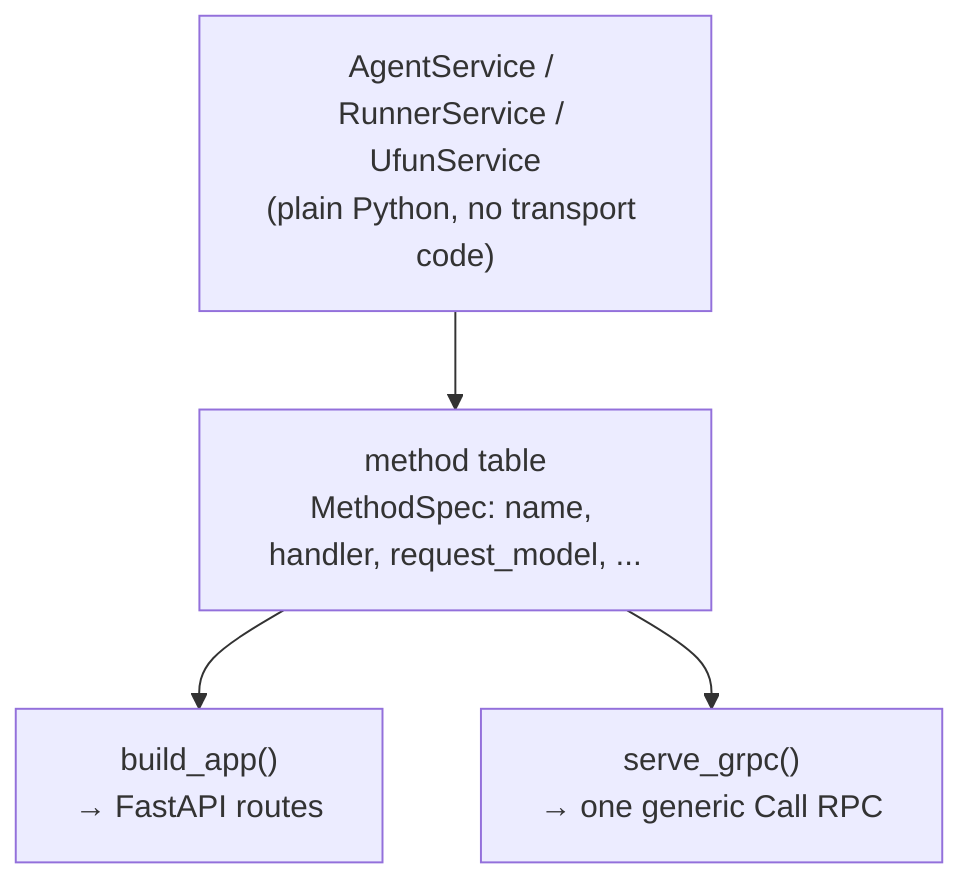

# Transports

Every inter-process hop in negmasd goes over a **pluggable transport**. HTTP
(FastAPI + httpx) is always available; **gRPC** is available as an optional
extra. Negotiation logic knows nothing about either.

| Protocol | Availability | Serves via | Client |
|----------|--------------|-----------|--------|
| `http` *(default)* | always | uvicorn + FastAPI | `httpx` |
| `grpc` | `uv sync --extra grpc` | `grpc.aio` server | blocking `grpc` stub |

## How it fits together

Each role is a plain Python **`Service`** with no transport code. It declares a
**method table** — one `MethodSpec` per endpoint — and every transport adapter is
a projection of that one table. Adding a protocol therefore touches no
negotiation logic, and the protocols cannot drift apart because they read the
same declaration.



Client-side, a **`Channel`** is a connection to one peer, addressed by
`Address(host, port, protocol)`. It offers **both** call forms, and both are
needed:

- `acall` — awaited; used by the handshake calls (`accept-negotiation`,
  `init-negotiation`, `run-negotiation`, `receive-results`).
- `call` — blocking; used by the per-round `respond`, because the mechanism's run
  loop is synchronous (it runs under `asyncio.to_thread`).

Channels are cached per `(protocol, host, port)` for the process lifetime — that
cache *is* the connection reuse, so the per-round call rides one already-open
connection instead of dialling every round. `close_all_channels()` resets it.

## Choosing a protocol

Two independent places name a protocol:

**1. How a service listens** — a CLI flag:

```bash
negmasd runner --port 9010 --protocol grpc
negmasd agent 8001 --config buyer.yml --protocol grpc
negmasd ufun 9100 --protocol grpc
negmasd builtin procurement --protocol grpc
```

**2. How a service is called** — config fields (see
[Configuration](configuration.md)):

```yaml
protocol: grpc            # how this agent itself serves
runner_protocol: grpc     # how to reach the runner
negotiations:
  trade:
    partners:
      - { name: buyer,  host: 127.0.0.1, port: 8001, protocol: grpc }
      - { name: seller, host: 127.0.0.1, port: 8002, protocol: grpc }
```

Both default to `http`, so nothing opts into gRPC by accident. The two must
agree: a partner listening on gRPC has to be addressed with `protocol: grpc`.

!!! tip "Mixed deployments work"
    The protocol is per-address, not global. One party can serve gRPC while
    another serves HTTP, as long as each is addressed with the protocol it
    actually speaks.

## gRPC is optional, and stays optional

`grpcio` is a compiled wheel that fails to build on some Python installations.
So it is never a hard dependency:

- `uv sync` alone gives a **fully working** installation — the CLI, all three
  roles, and the whole test suite (the gRPC cases skip).
- The transport registry stores only a *module-path string* for `grpc`, resolved
  on first use. Nothing imports `grpc` until a gRPC peer is actually addressed.
- Asking for gRPC without the extra gives one actionable line, not a traceback:

```console
$ negmasd runner --port 9010 --protocol grpc
serving protocol 'grpc' is not available: No module named 'grpc'.
Install the optional extra with `uv sync --extra grpc`.
```

`tests/test_transport_optional.py` enforces all of this by blocking the `grpc`
import in a subprocess, so it is checked whether or not the extra is installed.

## Why gRPC carries JSON, not typed messages

The `.proto` declares exactly one RPC:

```proto
service Negmasd { rpc Call (CallRequest) returns (CallReply); }
message CallRequest { string method = 1; string payload = 2; }  // payload: JSON
message CallReply  { string payload = 1; string error = 2; }
```

That is deliberate, for two structural reasons — not to save effort:

1. **Config models are open-ended by design.** `OutcomeSpaceModel`,
   `NegotiatorModel`, `MechanismModel` and `UtilityFunctionModel` set pydantic
   `extra = "allow"` precisely so arbitrary negmas constructor kwargs ride along
   into `make_object`. A fixed protobuf message cannot express that.
2. **The wire must stay plain JSON of values.** That is what lets agents run
   different Python versions on different machines (see
   [Exact parity](parity.md)). Generated messages would make the schema a build
   artifact both ends must share.

`negmasd.wire` remains the explicit schema for the one hot payload
(`SAOState` / `SAOResponse`); the envelope only moves bytes.

The generated stubs are **checked in**, so running over gRPC needs only
`grpcio` — never the compiler. Regenerate them with
`src/negmasd/transport/regen_proto.sh` (needs the dev group).

## Invariants worth knowing

These are enforced by tests; they explain some otherwise-odd details.

**A method's *name* is addressable on every transport.** gRPC dispatches by
name, so `build_app` also publishes a `/<name>` alias whenever a spec overrides
its HTTP path. Only the root health check does (its path is `/`, its name is
`root`), so `/root` is a hidden alias for `/`. Without it a caller could reach a
method over gRPC and get a 404 over HTTP.

**`http_method` is a hint.** It is read only by the FastAPI adapter — gRPC has no
GET/POST distinction — and `HttpChannel` retries with the other verb on a `405`.
So protocol-agnostic call sites need not know which endpoints happen to be GETs.
(The hot path passes the right verb, so this costs nothing there; a genuinely
wrong route costs one extra round trip before erroring.)

**`respond` is never round-tripped through a model.** Its wire payload passes
through as a raw dict. A pydantic round-trip is exactly where `ResponseType`
collapses to `{}` and outcome tuples degrade to lists — the two invariants in
[Exact parity](parity.md).

## Adding a protocol

Implement a `Channel` (both `call` and `acall`) plus a serve function, then
register them:

```python
from negmasd.transport import register_server, register_transport

register_transport("mqtt", "mypkg.mqtt:MqttChannel", install_hint="pip install …")
register_server("mqtt", "mypkg.mqtt:serve_mqtt", install_hint="pip install …")
```

Register by *string* if the implementation needs an optional dependency; it is
then imported only when that protocol is used. No negotiation code changes.
