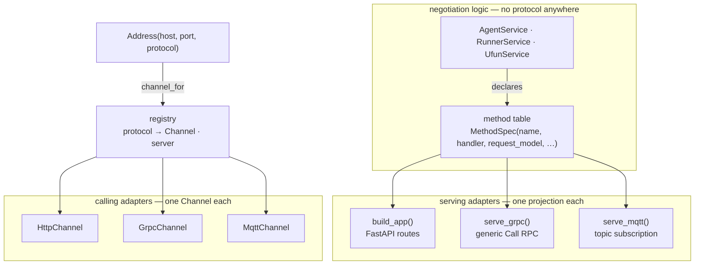

# Transports

Every inter-process hop in negmasd goes over a **pluggable transport**. HTTP
(FastAPI + httpx) is always available; **gRPC** and **MQTT** are optional extras.

| Protocol | Availability | Serving side | Client side | Shape |
|----------|--------------|--------------|-------------|-------|
| `http` *(default)* | always | uvicorn + FastAPI routes | `httpx` | request/response |
| `grpc` | `uv sync --extra grpc` | `grpc.aio` server, one generic RPC | blocking `grpc` stub | request/response |
| `mqtt` | `uv sync --extra mqtt` | `paho` subscriber on a topic | `paho` publisher | pub/sub via a broker |

The third column already differs wildly — a web framework, an HTTP/2 RPC server,
and a broker subscription. The point of this page is the part that *doesn't*
differ.

## The transport-independent design

**No negotiation code names a protocol.** `AgentService`, `RunnerService` and
`UfunService` contain no networking whatsoever, and `SAORemoteNegotiator` and
`RemoteUtilityFunction` do not know how their bytes travel. Three small contracts
in `negmasd/transport/base.py` make that true.



### 1. `Service` + the method table — the server-side contract

A role declares *what it can do* once, as data:

```python
class UfunService(Service):
    def methods(self):
        return (
            MethodSpec("root", "root", http_method="get", path="/"),
            MethodSpec("load-config", "load_config", PathRequest, ResponseModel,
                       http_method="get"),
            MethodSpec("meta", "meta", dict),
            MethodSpec("eval", "eval_outcome", dict),
        )
```

Each adapter is a *projection* of that one table. Nothing is registered twice, so
the protocols cannot drift apart — a method added here appears on all three at
once, and `tests/test_grpc_parity.py::test_http_and_grpc_expose_the_same_methods`
asserts the projections still agree.

`Service.dispatch(name, payload)` validates the payload into the spec's
`request_model` and calls the handler. The gRPC and MQTT adapters are little more
than a byte-decoder in front of `dispatch`.

### 2. `Channel` — the client-side contract

A `Channel` is a connection to **one peer**, with two call forms:

```python
class Channel(ABC):
    def call(self, method, payload, *, http_method="post") -> Any: ...        # blocking
    async def acall(self, method, payload, *, http_method="post") -> Any: ... # awaitable
```

Both are mandatory, and the reason is structural rather than stylistic:

- the handshake calls (`accept-negotiation`, `init-negotiation`,
  `run-negotiation`, `receive-results`) happen inside the event loop → `acall`;
- the per-round `respond` is issued from `Mechanism.run`, which is **synchronous**
  and runs under `asyncio.to_thread` → `call`.

A transport offering only an async client could not serve the hot path without
re-entering the event loop from a worker thread. Both gRPC and MQTT therefore
implement `call` natively and derive `acall` with `asyncio.to_thread`.

### 3. `Address` + the registry — how a peer is named

`Address(host, port, protocol)` says *which peer* and *how to reach it*.
`channel_for(address)` resolves the protocol through a registry and caches one
channel per `(protocol, host, port)` for the process lifetime — that cache **is**
the connection reuse, so the per-round call rides an already-open connection
instead of dialling every round. `close_all_channels()` resets it.

Because the protocol lives in the address, it is per-peer: one party may serve
gRPC while another serves HTTP, as long as each is addressed with what it speaks.

## The same call, three transports

Here is one `respond` call — the hot path, once per negotiation round — travelling
over each transport. The negotiator issuing it and the agent answering it are
byte-for-byte identical in all three rows; `negmasd/wire.py` produces the same
JSON regardless.

| | `http` | `grpc` | `mqtt` |
|---|---|---|---|
| **Client issues** | `POST /respond` | `Call{method:"respond", payload:…}` | publish to `negmasd/<node>/rpc` |
| **Carries** | JSON body | JSON string in a protobuf field | JSON with `id` + `reply_to` |
| **Reaches server via** | a FastAPI route | the generic `Call` handler | a topic subscription |
| **Server then calls** | `service.respond(req)` | `service.dispatch("respond", …)` | `service.dispatch("respond", …)` |
| **Reply travels** | HTTP response | `CallReply{payload}` | publish to `reply_to` |
| **Correlation** | the TCP request | the RPC | `id` matched in the payload |
| **Endpoint is** | a TCP socket | a TCP socket | a topic on a broker |

Concretely, the same code drives all three — only the address changes:

```python
channel_for(Address("127.0.0.1", 8001, "http")).call("respond", payload)
channel_for(Address("127.0.0.1", 8001, "grpc")).call("respond", payload)
channel_for(Address("127.0.0.1", 8001, "mqtt")).call("respond", payload)
```

And the same is true of a whole negotiation: `tests/transport_harness.py` builds
one scenario, one set of configs and one driving routine, and the gRPC and MQTT
suites differ *only* in how the three services are started. Both assert bit-exact
parity against the same in-process negmas reference.

## What is specific to each transport

### HTTP

`build_app(service)` registers one FastAPI route per `MethodSpec`, preserving the
paths, verbs and response models the endpoints had when they were hand-decorated,
so `/docs` and every existing URL still work. `HttpChannel` holds one
`httpx.Client` for its lifetime.

### gRPC

One generic RPC, *not* typed messages per endpoint:

```proto
service Negmasd { rpc Call (CallRequest) returns (CallReply); }
message CallRequest { string method = 1; string payload = 2; }  // payload: JSON
message CallReply  { string payload = 1; string error = 2; }
```

That is deliberate, for two structural reasons. First, the config models
(`OutcomeSpaceModel`, `NegotiatorModel`, `MechanismModel`,
`UtilityFunctionModel`) set pydantic `extra = "allow"` precisely so arbitrary
negmas constructor kwargs ride along into `make_object` — an open-ended kwargs bag
is not expressible as a fixed protobuf message. Second, the wire must stay plain
JSON of values so agents can run different Python versions on different machines
(see [Exact parity](parity.md)); generated messages would make the schema a build
artifact both ends must share.

The server is `grpc.aio` because `RunnerService.run_negotiation` calls
`asyncio.create_task` and so needs a live event loop. The generated stubs are
**checked in**, so running over gRPC needs only `grpcio`, never the compiler;
regenerate with `src/negmasd/transport/regen_proto.sh` (needs the dev group).

### MQTT

MQTT is broker-mediated pub/sub, so "where is the peer" splits in two. negmasd
resolves that split so **an existing HTTP config becomes an MQTT config by
changing `protocol:` alone**:

- `Address(host, port)` keeps meaning *which peer*. The topic is *derived* from
  it: `negmasd/<host>_<port>/rpc`. Both ends compute that from config they already
  share, so it cannot disagree and needs no new field.
- The **broker** is process-level deployment config (`--broker`,
  `NEGMASD_MQTT_BROKER`, default `127.0.0.1:1883`), not a per-peer setting — a node
  talks to one broker however many peers it addresses.

Request/response is layered on pub/sub with the correlation id *inside* the
payload rather than using MQTT 5 response-topic properties, so it works against
any broker on 3.1.1 or 5:

```text
request  → negmasd/<node>/rpc        {"id", "method", "payload", "reply_to"}
response → the request's `reply_to`  {"id", "payload", "error"}
```

As with gRPC, the server owns a thread running an asyncio loop, because the paho
callback thread has none and `run_negotiation` needs one.

!!! warning "`host:port` is an identifier here, not an endpoint"
    Nothing binds it. Two services claiming the same `host:port` against one broker
    will collide, and unlike a real port there is no "address already in use" to
    tell you. A serving process must be started with the `--host`/port its peers
    have configured for it — `--host` is the *identity* peers use, never a bind
    address. `serve_mqtt` logs the topic it listens on, and a client whose call
    times out names the topic it published to, so a mismatch is quick to spot.

!!! warning "A request sent before the peer subscribes is silently dropped"
    A QoS-1 publish to a topic with no subscriber is discarded by the broker — no
    error, no retry. A call to a peer that has not finished starting therefore waits
    out its whole timeout, where HTTP and gRPC fail fast on connect. Poll for
    readiness with a **short timeout and retries** (what
    `tests/transport_harness.py::wait_ready` and the CLI's config auto-loader do)
    rather than one long call.

One broker per process: `--broker` is process-wide, so a single process cannot
bridge two brokers today.

## Choosing a protocol

Two independent places name a protocol.

**1. How a service listens** — a CLI flag:

```bash
negmasd runner --port 9010 --protocol grpc
negmasd agent 8001 --config buyer.yml --protocol grpc
negmasd ufun 9100 --protocol grpc
negmasd builtin procurement --protocol grpc
```

MQTT additionally needs the broker, and `--host` as its topic identity:

```bash
negmasd runner --port 9010 --protocol mqtt --broker broker.local:1883
negmasd agent 8001 --config buyer.yml --protocol mqtt --broker broker.local:1883
```

`negmasd builtin` supports `http` and `grpc` only — its whole job is allocating
real ports, which MQTT has none of. It exits with a message naming the single-role
commands to use instead.

**2. How a service is called** — config fields (see
[Configuration](configuration.md)):

```yaml
protocol: grpc            # how this agent itself serves
runner_protocol: grpc     # how to reach the runner
negotiations:
  trade:
    partners:
      - { name: buyer,  host: 127.0.0.1, port: 8001, protocol: grpc }
      - { name: seller, host: 127.0.0.1, port: 8002, protocol: grpc }
```

All default to `http`, so nothing opts into an extra by accident. The two must
agree: a partner listening on gRPC has to be addressed with `protocol: grpc`.

## The optional transports stay optional

`grpcio` is a compiled wheel that fails to build on some Python installations, and
`paho-mqtt` is only wanted by MQTT deployments. Neither is ever a hard dependency:

- `uv sync` alone gives a **fully working** installation — the CLI, all three
  roles, and the whole test suite (the gRPC and MQTT cases skip).
- The registry stores only a *module-path string* for each optional protocol,
  resolved on first use. Nothing imports `grpc` or `paho` until a peer using that
  protocol is actually addressed.
- Asking for one without its extra gives one actionable line, not a traceback:

```console
$ negmasd runner --port 9010 --protocol mqtt
serving protocol 'mqtt' is not available: No module named 'paho'.
Install the optional extra with `uv sync --extra mqtt`.
```

`tests/test_transport_optional.py` enforces this for both protocols by blocking the
import in a subprocess, so it is checked whether or not the extras are installed.

## Invariants worth knowing

Enforced by tests; they explain some otherwise-odd details.

**A method's *name* is addressable on every transport.** gRPC and MQTT dispatch by
name, so `build_app` also publishes a `/<name>` alias whenever a spec overrides its
HTTP path. Only the root health check does (path `/`, name `root`), so `/root` is a
hidden alias for `/`. Without it, a caller could reach a method over gRPC or MQTT
and get a 404 over HTTP.

**`http_method` is a hint.** Only the FastAPI adapter reads it — gRPC and MQTT have
no GET/POST distinction — and `HttpChannel` retries with the other verb on a `405`,
so protocol-agnostic call sites need not know which endpoints happen to be GETs.

**`respond` is never round-tripped through a model.** Its wire payload passes
through as a raw dict. A pydantic round-trip is exactly where `ResponseType`
collapses to `{}` and outcome tuples degrade to lists — the two invariants in
[Exact parity](parity.md).

## Adding a protocol

Implement a `Channel` (both `call` and `acall`) plus a serve function, then
register them:

```python
from negmasd.transport import register_server, register_transport

register_transport("amqp", "mypkg.amqp:AmqpChannel", install_hint="pip install …")
register_server("amqp", "mypkg.amqp:serve_amqp", install_hint="pip install …")
```

Register by *string* if the implementation needs an optional dependency; it is then
imported only when that protocol is used. No negotiation code changes.

MQTT is the worked example of how cheap this is meant to be: adding it changed
**zero lines** in `transport/http.py` and `transport/grpc.py`, and added no field to
`Address` or to any config model. What it touched outside its own new module was
two registration lines, the CLI's protocol help plus `--broker`, and the list of
protocols in the optionality test.
